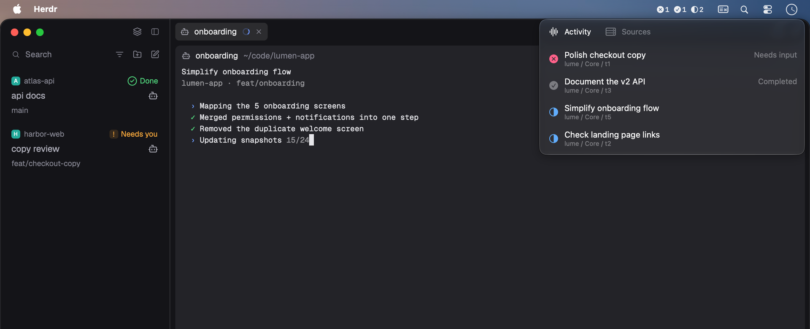
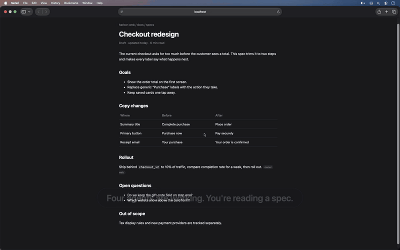

# Herdling

[English](README.md) | [简体中文](README.zh-CN.md)

Herdling is a macOS menu bar companion for [Herdr](https://herdr.dev/). Monitor legacy Herdr sessions and [Herdr Core](https://github.com/herdrdev/herdr-core) together. Legacy targets open in [Ghostty](https://ghostty.org/) or [Kero](https://kero.sh/); Core targets open in the native Herdr App.

**[Download Herdling for macOS →](https://github.com/JinJieBeWater/herdling/releases/latest)** · One Universal2 app for Apple Silicon and Intel

Requires **macOS 15+**. Legacy Herdr uses **Ghostty 1.4+** or **Kero with its `kero` CLI**. Core uses the **native Herdr App** connected to the same Core.

## What it does

- **Activity** shows blocked, done, working, and recent idle states from both runtimes. Core activity follows the native Herdr App's seen-based states, not raw Core reports. Idle ordering follows status changes, not saved navigation history. Terminals without an App status appear only in Sources.
- **Sources** browses legacy sessions, Spaces, and worktrees, alongside Core terminals grouped by machine. A Core terminal can be an ordinary shell; listing it does not make it an AI agent. Expand one source at a time, or keep them all closed.
- **Terminal jumps** reuse or create a verified Ghostty/Kero client for legacy Herdr. Core targets focus their existing pane in Herdr App and bring that App forward; the terminal preference does not affect Core.
- **Local + remote** activity stays current through runtime socket event streams. Legacy SSH sources come from `~/.ssh/config`, including `Include` files; Core uses its own machines. Both runtimes can run at once without a mode switch.

Core completion prompts follow Herdr App's own seen state, including changes made outside Herdling. Herdling refreshes that state after a jump and does not maintain a separate unread queue. See [runtime boundaries](docs/development.md#runtime-boundaries).

## Demo

Watch the [23-second demo (MP4)](docs/media/herdling-demo.mp4): find a blocked task in Activity, jump to Ghostty, approve the sample change, then browse Sources and open another project. Recorded in an isolated macOS VM with scripted sample tasks; waiting time is trimmed. No real work sessions or AI inference are shown. Core, SSH, and Kero are not demonstrated.

## Install

1. Download the ZIP and its `.zip.sha256` file from the [latest release](https://github.com/JinJieBeWater/herdling/releases/latest). In the download directory, verify with `shasum -a 256 -c <filename>.zip.sha256`.
2. Extract `Herdling.app` and move it to `/Applications` before opening it or enabling Launch at Login.

> Builds are **ad-hoc signed, without Apple Developer ID or notarization**. macOS may block the first launch. After attempting to open the app, use **System Settings → Privacy & Security → Open Anyway** only if you trust the download. Do not disable Gatekeeper system-wide. System permissions may need approval again after an ad-hoc-signed update.

From **0.2.0**, right-click the menu bar icon → **Check for Updates…**. Background checks are controlled by **Settings → General → Automatically check for updates**. Sparkle verifies the signed feed and archive before installation; installing and restarting require confirmation. This does not replace Developer ID or notarization. Older releases without Sparkle need one manual installation.

## Setup

1. Start a legacy Herdr session or your usual Herdr Core, then click Herdling in the menu bar. If both are running, Herdling monitors both.
2. Open **Settings** with `⌘,` or by right-clicking the menu bar icon. Core always opens in Herdr App and needs no setup. If legacy Herdr is installed, choose **Ghostty** (default) or **Kero** under **Legacy Herdr → Terminal**; existing preferences are preserved.
3. **Ghostty:** allow Herdling to control Ghostty when macOS asks, keep `macos-applescript` enabled (the default), and choose Tab or Window for new clients. **Kero:** uses its native CLI; no Automation permission or Tab/Window setting is needed.
4. **Optional legacy SSH:** enable named hosts under **Legacy SSH Sources**. Each host needs legacy Herdr, non-interactive SSH access, and `nc` with Unix-domain socket support. These selections affect only legacy sessions. Core uses the machines already configured in Core. See [remote setup and connection check](docs/development.md#remote-hosts).

## Controls

| Action | Result |
| --- | --- |
| Left-click menu bar icon | Open or close roster |
| Right-click menu bar icon | Open Settings, updates, and Quit menu |
| Click a machine in Sources | Toggle its directory; expanding one closes the previous source |
| Click a legacy agent, worktree, Space, or session | Focus it in the selected terminal |
| Click a Core terminal | Focus its existing pane in Herdr App |
| `↑` / `↓` | Select a row without navigating |
| `Enter` | Open selected target; source rows only toggle their directory |
| `←` / `→` in Sources | Return to parent / collapse or expand a source |
| `Tab` / `Shift-Tab` | Move among native controls |
| `⌘,` | Open Settings |
| `⌘W` in Settings | Close the Settings window |
| `Esc` in roster | Close panel |
| `⌘Q` | Quit Herdling |

Legacy Herdr focus can mark every pane in the destination tab as seen and affect all shell clients in that session. Core follows Herdr App's native focus and seen rules. A failed jump may already have changed focus; it does not imply rollback or that a task was handled. Failures never open a different application as a fallback.

## Development and troubleshooting

[Build from source, tests, SSH setup, architecture, release signing, and troubleshooting](docs/development.md). Source builds require Xcode 26.2+ with Swift 6.2+; Command Line Tools alone are not sufficient.

## License

Herdling itself does not currently declare a software license. See [third-party notices](Resources/THIRD_PARTY_NOTICES.md) for the bundled Herdr mark and Sparkle, including their original license texts.
