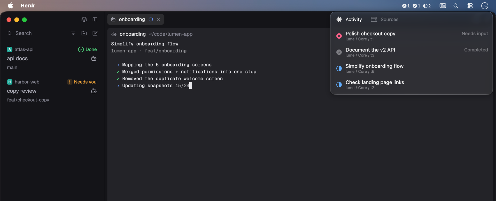
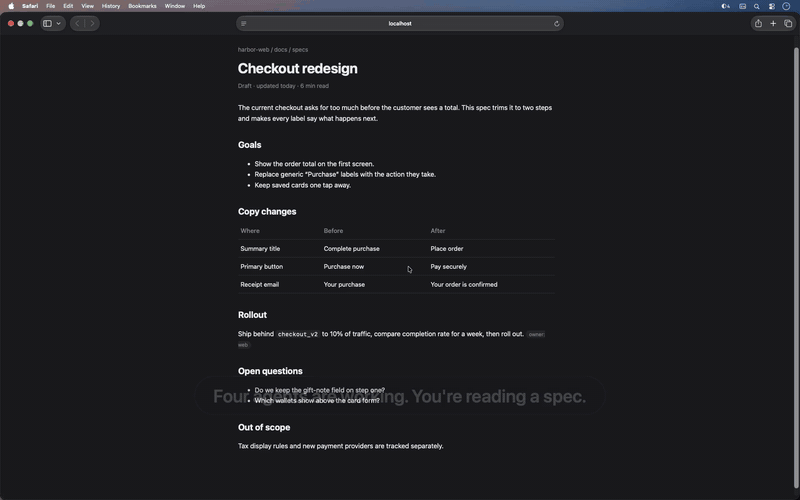

# Herdling

[English](README.md) | [简体中文](README.zh-CN.md)

Herdling 是 [Herdr](https://herdr.dev/) 的 macOS 菜单栏配套工具，同时监控旧版 Herdr Session 和 [Herdr Core](https://github.com/herdrdev/herdr-core)。旧版目标在 [Ghostty](https://ghostty.org/) 或 [Kero](https://kero.sh/) 中打开，Core 目标在原生 Herdr App 中打开。

**[下载 macOS 版 Herdling →](https://github.com/JinJieBeWater/herdling/releases/latest)** · 一个 Universal2 应用，同时支持 Apple Silicon 和 Intel

需要 **macOS 15+**。旧版 Herdr 使用 **Ghostty 1.4+** 或 **Kero 及其 `kero` CLI**；Core 使用连接到同一 Core 的**原生 Herdr App**。

## 功能

- **Activity** 展示两套运行时的 blocked、done、working 和最近 idle 状态。Core 使用 Herdr App 结合 seen 得出的状态，不直接展示 Core 原始报告。idle 按状态变化排序，不按定位历史排序；没有 App 状态的终端只出现在 Sources。
- **Sources** 浏览旧版的 Session、Space、worktree，以及按设备分组的 Core 终端。Core 终端可以只是普通 shell，列入目录不表示它是 AI agent。一次可展开一个来源，也可全部收起。
- **终端跳转** 为旧版 Herdr 复用或新建并验证 Ghostty/Kero client。Core 定位到 Herdr App 中已有的 pane 并将 App 置前，不受终端偏好影响。
- **本机 + 远程** 活动通过各自的 Socket 事件流同步。旧版 SSH 来源读取自 `~/.ssh/config`，包括 `Include` 文件；Core 沿用自身的 machine 配置。两套运行时可以同时运行，无需切换模式。

Core 完成提示沿用 Herdr App 的 seen 状态，也会同步直接在 App 中查看后的变化。跳转后重新读取 App 状态，不另建未读队列。参见[运行时边界](docs/development.zh-CN.md#运行时边界)。

## 演示

查看 [34 秒演示（MP4）](docs/media/herdling-demo.mp4)：在 Safari 中阅读时，一个 agent 请求批准。Herdling 在菜单栏和 Activity 顶部提示，一次点击打开它在 Herdr App 中的 pane，在那里批准。回到 Safari 后另一个 agent 完成，从 Activity 打开即标记为已查看，菜单栏提示随之清除。Sources 列出全部 Core 终端，包括普通 shell。使用 Herdr App 0.1.12、Herdr Core 和 [Herdr T3](https://github.com/JinJieBeWater/herdr-t3) 布局，在隔离 macOS VM 中以脚本化示例任务实时录制；不含真实工作会话或 AI 推理，未演示旧版 Herdr、SSH 或 Kero。

## 安装

1. 从[最新发行版](https://github.com/JinJieBeWater/herdling/releases/latest)下载 ZIP 和对应的 `.zip.sha256` 文件，在下载目录执行 `shasum -a 256 -c <文件名>.zip.sha256` 校验。
2. 解压 `Herdling.app`，在打开或启用登录时启动前，将其移动到 `/Applications`。

> 发行版使用 **ad-hoc 签名，没有 Apple Developer ID，也未公证**。macOS 可能拦截首次启动。尝试打开后，仅在信任下载来源时，前往 **系统设置 → 隐私与安全性 → 仍要打开** 放行。不要全局关闭 Gatekeeper。ad-hoc 签名更新后，系统权限可能需要重新批准。

从 **0.2.0** 开始，右键点击菜单栏图标 → **Check for Updates…**。**Settings → General → Automatically check for updates** 控制后台检查。Sparkle 在安装前校验签名 feed 和下载包；安装及重启需要确认。这不替代 Developer ID 或公证。没有 Sparkle 的旧版需手动安装一次新版。

## 配置

1. 启动旧版 Herdr Session 或平时使用的 Herdr Core，然后点击菜单栏中的 Herdling。两者同时运行时，Herdling 同时监控。
2. 按 `⌘,` 或右键点击菜单栏图标，打开 **Settings**。Core 固定在 Herdr App 中打开，无需配置。装有旧版 Herdr 时，在 **Legacy Herdr → Terminal** 中选择 **Ghostty**（默认）或 **Kero**；原有偏好保留。
3. **Ghostty：** 按 macOS 提示允许 Herdling 控制 Ghostty，保持 `macos-applescript` 启用（默认值），并选择新 client 使用 Tab 还是 Window。**Kero：** 使用原生 CLI，无需自动化权限或 Tab/Window 设置。
4. **可选旧版 SSH：** 在 **Legacy SSH Sources** 中启用命名主机。每台主机都需要旧版 Herdr、非交互式 SSH 登录，以及支持 Unix domain socket 的 `nc`。这些选择只影响旧版 Session；Core 沿用自身已配置的 machine。参见[远程配置与连接检查](docs/development.zh-CN.md#远程主机)。

## 操作

| 操作 | 结果 |
| --- | --- |
| 左键点击菜单栏图标 | 打开或关闭 agent 列表 |
| 右键点击菜单栏图标 | 打开 Settings、更新检查和 Quit 菜单 |
| 点击 Sources 中的设备 | 展开或收起目录；展开一个来源时收起前一个 |
| 点击旧版 agent、worktree、Space 或 Session | 在所选终端中聚焦目标 |
| 点击 Core 终端 | 在 Herdr App 中聚焦其已有 pane |
| `↑` / `↓` | 移动选择，不跳转 |
| `Enter` | 打开选中目标；来源行只展开或收起目录 |
| Sources 中的 `←` / `→` | 返回父层，或收起 / 展开来源 |
| `Tab` / `Shift-Tab` | 在原生控件间移动焦点 |
| `⌘,` | 打开 Settings |
| Settings 中的 `⌘W` | 关闭 Settings 窗口 |
| 面板内按 `Esc` | 关闭面板 |
| `⌘Q` | 退出 Herdling |

旧版 Herdr 定位可能将目标 tab 的所有 pane 标为 seen，并影响同一 Session 的多个 shell client。Core 沿用 Herdr App 自身的定位与 seen 规则。跳转失败也可能已改变焦点，不代表回滚，更不代表任务已处理；失败时不自动改用另一个应用。

## 开发与排障

[源码构建、测试、SSH 配置、架构、发布签名与排障](docs/development.zh-CN.md)。源码构建需要 Xcode 26.2+ 和 Swift 6.2+；只有 Command Line Tools 不够。

## 许可

Herdling 项目本身目前尚未声明软件许可证。内置 Herdr 标志与 Sparkle 的许可及原文见[第三方声明](Resources/THIRD_PARTY_NOTICES.md)。
