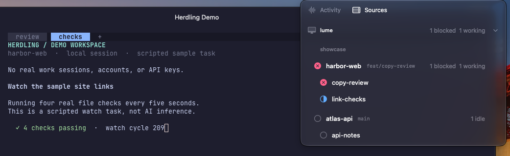
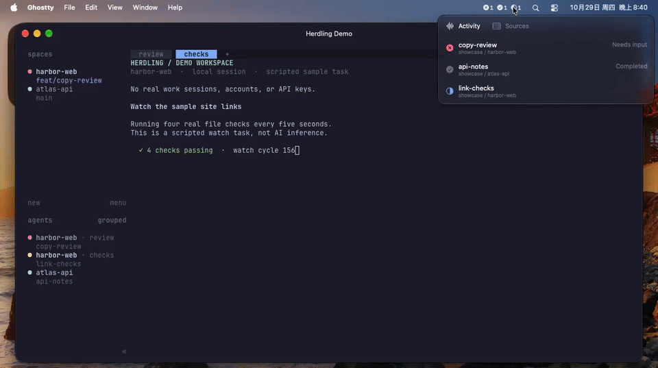

# Herdling

[English](README.md) | [简体中文](README.zh-CN.md)

Herdling 是 [Herdr](https://herdr.dev/) 的 macOS 菜单栏配套工具。查看本机和 SSH Session 中哪些 agent 需要关注，再跳转到 [Ghostty](https://ghostty.org/) 或 [Kero](https://kero.sh/) 中对应的终端。

**[下载 macOS 版 Herdling →](https://github.com/JinJieBeWater/herdling/releases/latest)** · 一个 Universal2 应用，同时支持 Apple Silicon 和 Intel

需要 **macOS 15+**、Herdr，以及 **Ghostty 1.4+** 或 **Kero 及其 `kero` CLI**。

## 功能

- **Activity** 优先显示 blocked agent，随后是 done、working、最近更新的三个 idle。idle 的新近程度来自 Herdr 状态时间戳，不是导航历史。
- **Sources** 按设备、Session、Space 和 worktree 浏览完整目录，保留 Herdr 原始顺序。一次可展开一个来源，也可全部收起。
- **终端跳转** 聚焦选中的 agent、worktree、Space 或 Session。Herdling 复用所选终端内匹配的 Herdr client，没有时新建并验证。
- **本机 + SSH** Session 通过 Herdr Socket 事件流同步状态，必要时使用发现机制和 CLI fallback。SSH 来源读取自 `~/.ssh/config`，包括 `Include` 文件。

## 演示

查看 [23 秒演示（MP4）](docs/media/herdling-demo.mp4)：在 Activity 中找到等待输入的任务，跳转到 Ghostty，批准示例改动，再浏览 Sources 并打开另一个项目。录制于隔离 macOS VM，使用脚本化示例任务，剪去了等待空档；不含真实工作会话或 AI 推理，未演示 SSH 或 Kero。

## 安装

1. 从[最新发行版](https://github.com/JinJieBeWater/herdling/releases/latest)下载 ZIP 和对应的 `.zip.sha256` 文件，在下载目录执行 `shasum -a 256 -c <文件名>.zip.sha256` 校验。
2. 解压 `Herdling.app`，在打开或启用登录时启动前，将其移动到 `/Applications`。

> 发行版使用 **ad-hoc 签名，没有 Apple Developer ID，也未公证**。macOS 可能拦截首次启动。尝试打开后，仅在信任下载来源时，前往 **系统设置 → 隐私与安全性 → 仍要打开** 放行。不要全局关闭 Gatekeeper。ad-hoc 签名更新后，系统权限可能需要重新批准。

从 **0.2.0** 开始，右键点击菜单栏图标 → **Check for Updates…**。**Settings → General → Automatically check for updates** 控制后台检查。Sparkle 在安装前校验签名 feed 和下载包；安装及重启需要确认。这不替代 Developer ID 或公证。没有 Sparkle 的旧版需手动安装一次新版。

## 配置

1. 启动至少一个 Herdr Session，然后点击菜单栏中的 Herdling。
2. 按 `⌘,` 或右键点击菜单栏图标，打开 **Settings**。在 **Terminal → Application** 中选择 **Ghostty**（默认）或 **Kero**。偏好会保存，只影响后续跳转。
3. **Ghostty：** 按 macOS 提示允许 Herdling 控制 Ghostty，保持 `macos-applescript` 启用（默认值），并选择新 client 使用 Tab 还是 Window。**Kero：** 使用原生 CLI，无需自动化权限或 Tab/Window 设置。
4. **可选 SSH：** 在 **SSH Sources** 中启用命名主机。每台主机都需要 Herdr、非交互式 SSH 登录，以及支持 Unix domain socket 的 `nc`。参见[远程配置与连接检查](docs/development.zh-CN.md#远程主机)。

## 操作

| 操作 | 结果 |
| --- | --- |
| 左键点击菜单栏图标 | 打开或关闭 agent 列表 |
| 右键点击菜单栏图标 | 打开 Settings、更新检查和 Quit 菜单 |
| 点击 Sources 中的设备 | 展开或收起目录；展开一个来源时收起前一个 |
| 点击 agent、worktree、Space 或 Session | 在所选终端中聚焦目标 |
| `↑` / `↓` | 移动选择，不跳转 |
| `Enter` | 打开选中目标；来源行只展开或收起目录 |
| Sources 中的 `←` / `→` | 返回父层，或收起 / 展开来源 |
| `Tab` / `Shift-Tab` | 在原生控件间移动焦点 |
| `⌘,` | 打开 Settings |
| Settings 中的 `⌘W` | 关闭 Settings 窗口 |
| 面板内按 `Esc` | 关闭面板 |
| `⌘Q` | 退出 Herdling |

Herdr 定位可能将目标 tab 的所有 pane 标为 seen，并影响同一 Session 的多个 shell client。跳转失败也可能已改变焦点，不代表回滚，更不代表任务已处理。

## 开发与排障

[源码构建、测试、SSH 配置、架构、发布签名与排障](docs/development.zh-CN.md)。源码构建需要 Xcode 26.2+ 和 Swift 6.2+；只有 Command Line Tools 不够。

## 许可

Herdling 项目本身目前尚未声明软件许可证。内置 Herdr 标志与 Sparkle 的许可及原文见[第三方声明](Resources/THIRD_PARTY_NOTICES.md)。
